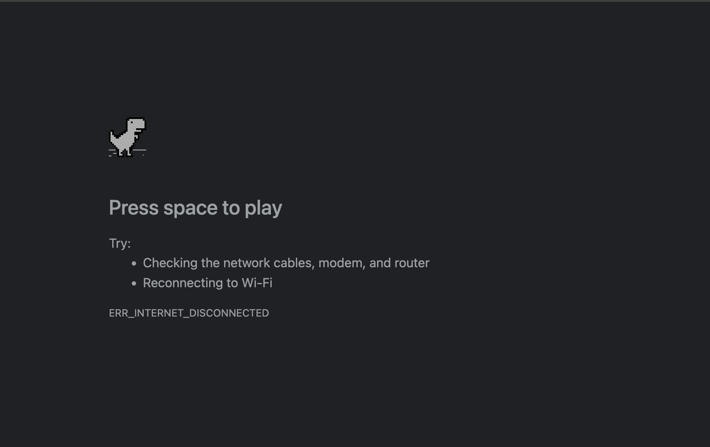
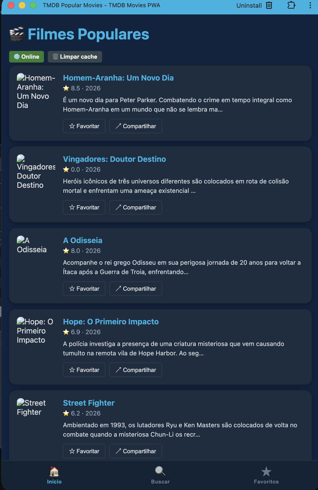
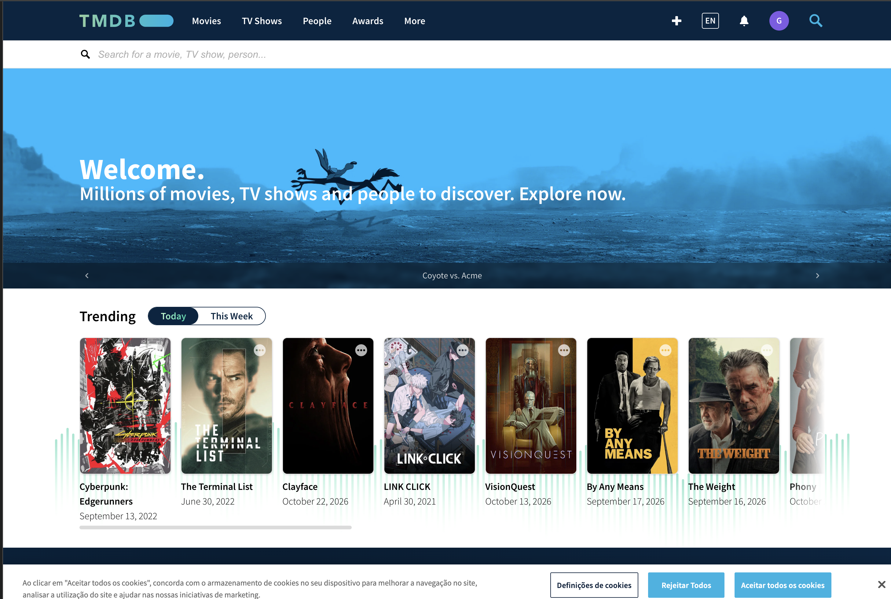
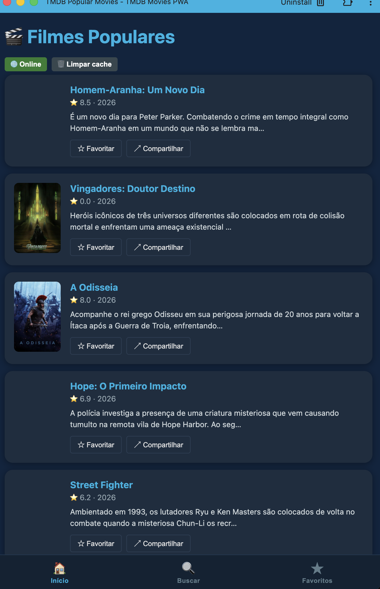
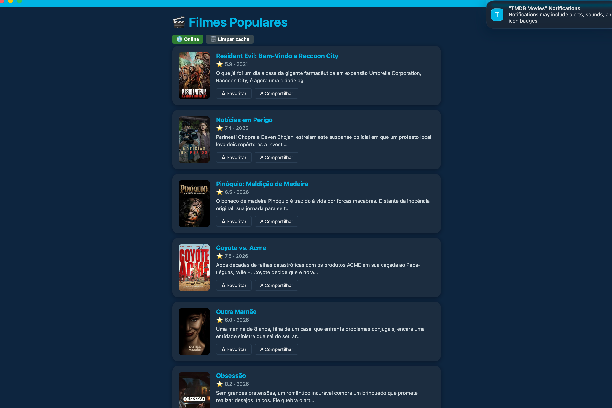
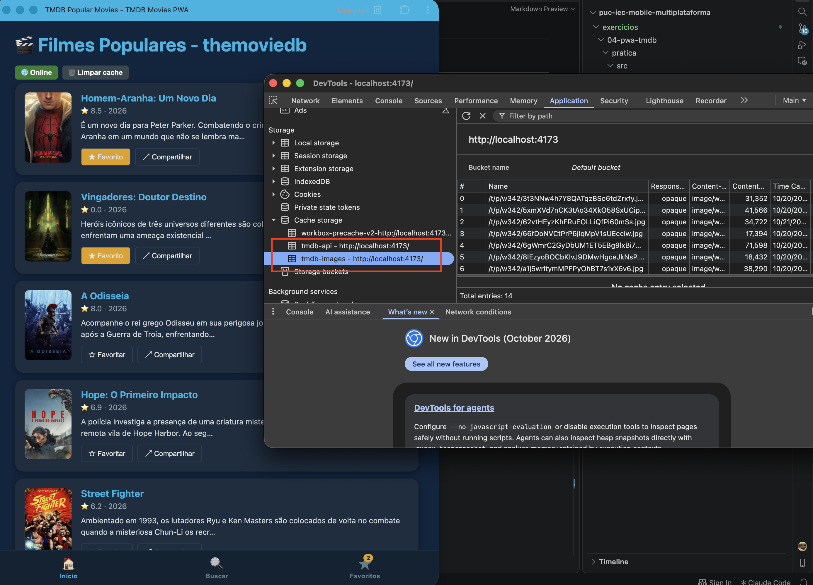
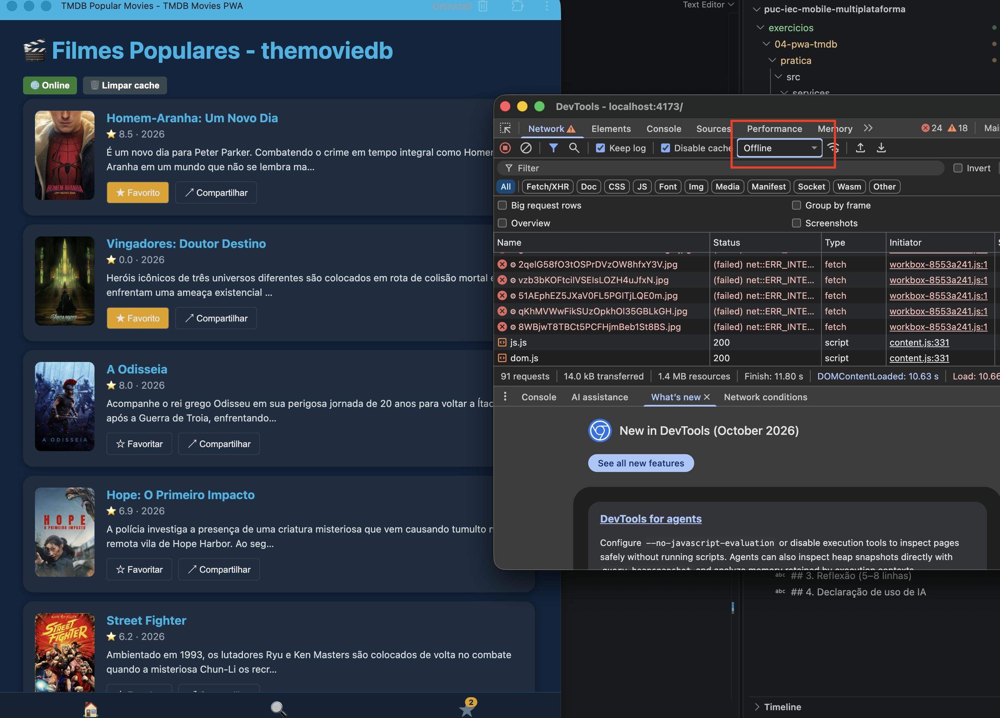
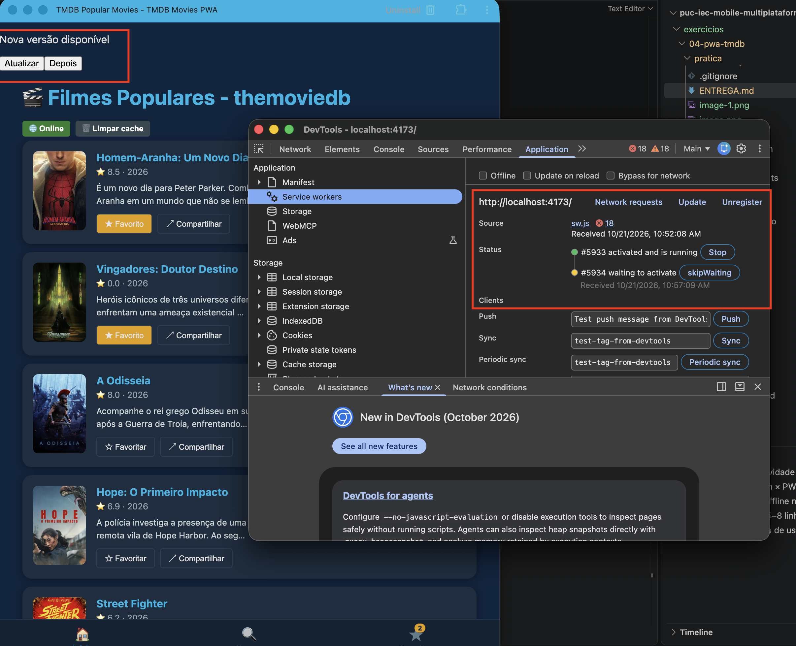

# ENTREGA — Atividade 4 (PWA)

**Nome:** Gabriel Moreira da Silva de Faria · **GitHub:** gabezy

---

## 1. Site comum × PWA — o que EU vi (3 diferenças)

Abra `https://pwa-tmdb-aula4.vercel.app` e compare com um site comum (ex.: themoviedb.org). Modo avião → recarregar; fechar e reabrir; instalar.

| # | Site comum | PWA | Print/evidência |
|---|---|---|---|
| 1 | Requer sempre conexão com a internet | Funcionamento Offline |   |
| 2 | Similar as web app normais | Experiência mais fluida e mais parecida com uma aplicação nativa | | 
| 3 | Não Tem funcionalidade de notificação | Tem funcionalidade de notificação | |

## 2. Prova do offline no SEU build

- [x] Print do **DevTools → Application → Cache Storage** com `tmdb-api` e `tmdb-images` (com itens)
    
- [x] Print do app em **modo avião** carregando a lista
    
- [x] Print do aviso **"Nova versão disponível"** (ou explique por que não conseguiu reproduzir)
    

(Coloque os prints numa pasta `evidencias/` e referencie aqui.)

## 3. Reflexão (5–8 linhas)

`autoUpdate` × `prompt`: qual você escolheria para um app de **checkout** e para um app de **notícias**, e por quê? O que pode dar errado em cada escolha?

Para o app de **notícias** eu escolheria `autoUpdate`: é um app majoritariamente de leitura, com poucos ou nenhum formulário, então se a página recarregar sozinha para aplicar a nova versão o usuário perde no máximo a posição de leitura — nada crítico — e em troca sempre recebe correções e o layout mais recente sem precisar fazer nada.
O risco é o reload acontecer no meio de uma leitura ou de um comentário sendo digitado, gerando uma pequena frustração.
Para o app de **checkout** eu escolheria `prompt`: se a atualização recarregar a página no meio do preenchimento, os dados do formulário (endereço, cartão, cupom) são perdidos, o que pode significar uma venda não concluída, carrinho abandonado ou até pagamento em estado inconsistente.
Com `prompt` o usuário decide o momento de atualizar (ex.: depois de finalizar a compra).
O risco aqui é o usuário ignorar o aviso e continuar por muito tempo numa versão antiga, possivelmente com bug ou incompatível com a API nova do backend.

## 4. Declaração de uso de IA

Usei IA? Onde e como? (uso transparente é incentivado)

Sim. Utilizei IA (Claude) para levantar os trade-offs das estratégias de atualização do PWA (`autoUpdate` × `prompt`) — principalmente o que pode dar errado em cada escolha — e para ajudar a redigir a reflexão da seção 3 a partir da minha ideia (autoUpdate para notícias, prompt para checkout).
